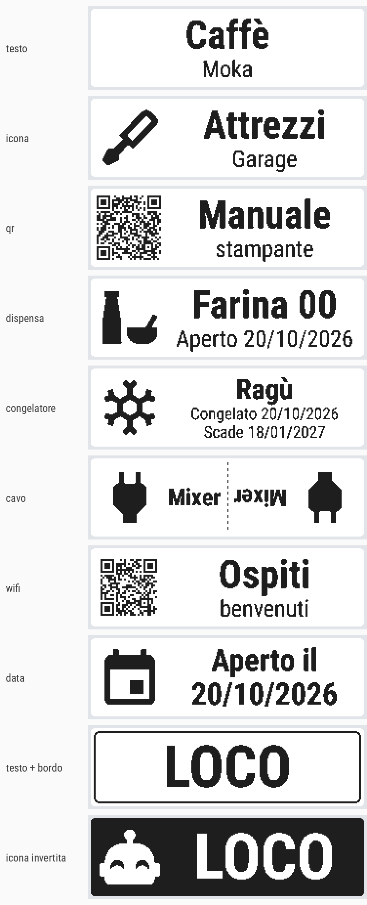

# ORGSTA S001 Label Printer per Home Assistant

Integrazione per la stampantina di etichette **ORGSTA S001** (quella dell'app *Snap & Tag*, prodotta da Xprinter / Zhuhai Hengmao). Stampa direttamente da Home Assistant via Bluetooth, anche passando dai **proxy Bluetooth ESPHome**, senza telefono.

*English: Home Assistant integration for the ORGSTA S001 Bluetooth label printer (Snap & Tag app). Prints through the HA Bluetooth stack, including ESPHome Bluetooth proxies. Install via HACS as a custom repository.*



## Installazione

1. HACS → menu ⋮ → **Repository personalizzati** → `https://github.com/morgandj01/ha-orgsta-s001`, categoria **Integrazione**
2. Scarica **ORGSTA S001 Label Printer** e riavvia Home Assistant
3. Accendi la stampante e chiudi Snap & Tag sul telefono: HA la trova da solo (Impostazioni → Dispositivi → Rilevati), oppure **Aggiungi integrazione → ORGSTA S001**

Serve almeno un adattatore Bluetooth o un proxy ESPHome con **connessioni attive** (`bluetooth_proxy: active: true`).

## Come funziona

- Quando la accendi HA se ne accorge dagli annunci Bluetooth e fa **una lettura sola** (batteria, coperchio, carta). Per il resto la stampante viene contattata solo quando stampi o premi *Aggiorna stato*: si collega, fa, si scollega. Così non occupa uno slot del proxy e il telefono può ancora usarla
- Se la tieni collegata al telefono (Snap & Tag) smette di farsi sentire e dopo qualche minuto HA la vede *spenta*
- Prima di stampare legge lo stato: se il coperchio è aperto o la carta è finita, si ferma e te lo dice
- Le etichette sono disegnate in orizzontale (il testo corre lungo l'etichetta)

## Entità

| Entità | Cosa fa |
|---|---|
| Stato | pronta, spenta, in stampa, coperchio aperto, carta finita, non raggiungibile |
| Stanza | dove sta: l'area del proxy Bluetooth che la sente meglio (si aggiorna da accesa); attributi `proxy`, `rssi` |
| Accesa | si accende da sola quando la stampante si accende: HA ascolta gli annunci Bluetooth che i proxy sentono già, senza collegarsi |
| Batteria | % letta all'ultima connessione |
| Coperchio, Carta finita, In stampa | sensori binari |
| Ultima stampa | quando e cosa (attributo `contenuto`) |
| Etichette stampate | contatore di tutte le etichette uscite |
| Rotolo | etichette uscite dal rotolo dentro (anche quelle vuote di *Avanza etichetta*); attributi `capienza`, `rimaste`, `contato_da_nuovo` |
| Etichette rimaste | quante ne restano nel rotolo, quando la capienza è nota e il rotolo è contato dall'inizio |
| Etichette in un rotolo | la capienza: la impara da sola quando la carta finisce su un rotolo contato da nuovo (più di 10 etichette), si può anche scrivere a mano |
| Rotolo contato da nuovo | acceso dopo *Rotolo nuovo*, si spegne quando ha imparato la capienza |
| Rotolo nuovo | pulsante da premere quando cambi il rotolo: il conto riparte da zero |
| Anteprima etichetta | immagine dell'ultima etichetta stampata o in anteprima |
| Carta caricata | il rotolo dentro (default 12 x 40 mm) |
| Intensità | 1-15, default 9 |
| Spostamento stampa | punti (8 = 1 mm) per centrare la stampa lungo l'etichetta; 0 = centrata sulla 12x40 (0.3.1) |
| Testo rapido + Stampa testo rapido | scrivi e stampa dalla dashboard. Usa `|` per la seconda riga: `Caffè|Moka` |
| Aggiorna stato, Avanza etichetta, Stampa di prova | pulsanti |

## Azione `orgsta_s001.print`

| Campo | Note |
|---|---|
| `layout` | `testo`, `icona`, `qr`, `dispensa`, `congelatore`, `cavo`, `wifi`, `data`, `immagine` |
| `title` | testo principale, `\n` per andare a capo |
| `subtitle` | riga piccola sotto |
| `icon` | qualsiasi icona mdi, es. `mdi:coffee` |
| `qr` | contenuto del QR (layout `qr`) |
| `date` | `oggi`, `domani`, `+7`, `2026-10-20`, `20/10/2026` |
| `expiry` | scadenza per dispensa/congelatore, anche `+90` |
| `date_prefix` | es. `Aperto`, `Fatto il` |
| `ssid`, `password` | layout `wifi` |
| `image` | URL, `/local/foto.png`, percorso consentito, `camera.xxx`, `image.xxx` |
| `border`, `invert`, `align` | cornice, bianco su nero, `center`/`left` |
| `paper` | se vuoto usa *Carta caricata* |
| `copies`, `density` | copie (max 20) e intensità |

`orgsta_s001.preview` accetta gli stessi campi, aggiorna l'anteprima senza stampare e restituisce il PNG in base64. `orgsta_s001.feed` fa uscire un'etichetta vuota.

### Esempi

```yaml
# Testo semplice
action: orgsta_s001.print
data:
  title: Caffè
  subtitle: Moka

# Icona + testo
action: orgsta_s001.print
data:
  layout: icona
  icon: mdi:screwdriver
  title: Attrezzi
  subtitle: Garage

# Barattolo aperto oggi
action: orgsta_s001.print
data:
  layout: dispensa
  title: Farina 00
  date_prefix: Aperto

# Congelatore con scadenza tra 3 mesi
action: orgsta_s001.print
data:
  layout: congelatore
  title: Ragù
  expiry: "+90"

# Bandierina per cavo (si piega a metà attorno al cavo)
action: orgsta_s001.print
data:
  layout: cavo
  title: Mixer
  icon: mdi:power-plug
  copies: 2

# Wi-Fi ospiti con QR
action: orgsta_s001.print
data:
  layout: wifi
  ssid: Ospiti
  password: benvenuti

# Foto di una telecamera
action: orgsta_s001.print
data:
  layout: immagine
  image: camera.ingresso
```

## Carte supportate

`12x40` (default), `14x40`, `14x30`, `14x22`, `14x50`, `12.5x74`, `14x40_trasparente`, `continuo_15` (con `length_mm`).

## Crediti

Il protocollo della S001 viene da [TiMini Print](https://github.com/Dejniel/TiMini-Print) di Dejniel (Apache 2.0), riscritto per Home Assistant. Icone [Material Design Icons](https://pictogrammers.com), font Roboto Condensed (OFL). Vedi `NOTICE`.
